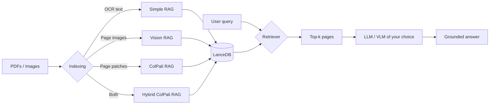

<h1 align="center">Prism: Vision-Language RAG Pipeline</h1>
<p align="center">
  <b>Vision-first RAG for documents: retrieve and answer over pages as images, not just extracted text.</b>
</p>

<p align="center">
  
  <a href="https://colab.research.google.com/github/sakshitiw18/prism/blob/main/docs/demo.ipynb"></a>
  
  
</p>

## Overview

Standard RAG pipelines flatten documents into text, which loses tables, charts, figures, and page layout. **Prism** is a vision-first retrieval engine that treats document pages as visual objects. It combines Vision-Language Models (VLMs) with traditional text retrieval so a single interface can answer questions over scanned PDFs, slide decks, infographics, and layout-heavy reports.

Prism exposes four retrieval strategies behind one consistent API, so you can swap techniques, compare them, and pick the best fit for your data without rewriting your pipeline.

## Key Features

- **Four interchangeable retrieval techniques** behind one `index()` / `search()` interface
- **Layout-aware retrieval** using page-level image embeddings (ColPali, JinaCLIP)
- **Two-stage hybrid retrieval**: fast coarse recall, then late-interaction reranking
- **OCR pipeline** for scanned documents via Docling
- **Token-level interpretability**: similarity heatmaps that show why a page was retrieved
- **Interactive playground** (Gradio) to compare techniques side by side
- **One-command GPU deployment** on Modal for cloud demos

## Architecture



## Retrieval Techniques

| Technique | How it works | Best for |
| :--- | :--- | :--- |
| **Simple RAG** | Extracts text with OCR (Docling), indexes passages, and matches queries to text chunks. | Text-heavy documents: contracts, books, papers |
| **Vision RAG** | Encodes text and images into a shared space with JinaCLIP, so images can be searched alongside text. | Figures, diagrams, product imagery |
| **ColPali RAG** | Embeds whole pages as images with PaliGemma and scores with ColBERT-style late interaction (token-level matching against page patches). | Tables, infographics, complex layouts |
| **Hybrid ColPali RAG** | Retrieves top-k pages with image embeddings, then reranks them with ColPali late interaction. | Mixed visual and text content where both accuracy and speed matter |

<details>
<summary><b>More detail on each technique</b></summary>

- **Simple RAG:** Optical Character Recognition through Docling makes scanned PDFs and images searchable. Extracted text is indexed so queries can be matched to relevant passages, giving a strong baseline for grounded generation.
- **Vision RAG:** A cross-modal embedding model (JinaCLIP) maps text and images into one vector space, enabling similarity search across modalities. Useful when visual components matter as much as the text.
- **ColPali RAG:** Pages are embedded directly as images, so layout and visual elements become part of retrieval. Late interaction enables token-level matching between query tokens and document patches, keeping accuracy high at reasonable indexing and query speeds.
- **Hybrid ColPali RAG:** A coarse first pass using image embeddings narrows the candidate pages, and a second pass reranks them with ColPali. This combines the speed of single-vector search with the precision of late interaction.
</details>

## Quickstart

### 1. Clone
```bash
git clone https://github.com/sakshitiw18/prism
cd prism
```

### 2. Create an environment
```bash
conda create -n prism-venv python=3.10
conda activate prism-venv
```

### 3. Install
```bash
pip install -e .
# or poetry install

# optional: OCR dependencies
pip install -e ".[ocr]"
```

## Usage

Every technique is a class with the same interface:

```python
from prism.rag import ColpaliRAG # or SimpleRAG, VisionRAG, HybridColpaliRAG

rag = ColpaliRAG()
rag.index(
    "/path/to/documents", # technique-specific options
)

results = rag.search("What was Q3 revenue by region?", top_k=5)
# Pass `results` to the LLM / VLM of your choice for answer generation
```

## Interactive Playground

Compare techniques from ingestion to retrieval in a Gradio interface:
```bash
python demo.py --share
```
Or run it in [Google Colab](https://colab.research.google.com/github/sakshitiw18/prism/blob/main/docs/demo.ipynb).

## Examples and Notebooks

| Technique | Notebook | Script |
| :--- | :--- | :--- |
| **Simple RAG** | [Colab](https://colab.research.google.com/github/sakshitiw18/prism/blob/main/docs/simpleRAG.ipynb) | [textDemo.py](examples/textDemo.py) |
| **Vision RAG** | [Colab](https://colab.research.google.com/github/sakshitiw18/prism/blob/main/docs/visionRAG.ipynb) | [visionDemo.py](examples/visionDemo.py) |
| **ColPali RAG** | [Colab](https://colab.research.google.com/github/sakshitiw18/prism/blob/main/docs/colpaliRAG.ipynb) | [colpaliDemo.py](examples/colpaliDemo.py) |
| **Hybrid ColPali RAG** | [Colab](https://colab.research.google.com/github/sakshitiw18/prism/blob/main/docs/hybridColpaliRAG.ipynb) | [hybridColpaliDemo.py](examples/hybridColpaliDemo.py) |

## ColPali Interpretability

Prism includes tooling to inspect how ColPali scores a page for a query:
- **Token-level analysis:** how each query token contributes to retrieval
- **Similarity heatmaps:** where on the page the model "looks"
- **Model comparison:** side-by-side analysis of ColPali variants
- **Gradio interface** for interactive exploration

```bash
python examples/inference_colpali/demo_with_heatmaps.py
```

## Cloud Deployment (Modal)

Run the ColPali comparison demo on a cloud GPU:

```bash
pip install modal
modal setup
# In the Modal dashboard, create a secret named `hf-secret` containing your Hugging Face token

python -m modal run examples/inference_colpali/modal_demo_heatmaps_comparing_colpali_models.py::comparision_demo
```

| Capability | Detail |
| :--- | :--- |
| **GPU** | Automatic L4 provisioning |
| **Model caching** | Persistent volume for fast cold starts |
| **Memory** | Tuned for T4/L4 constraints |
| **Scaling** | Pay-per-use, scales to zero |
| **Access** | Shareable Gradio URL |

Environment variables (in a `.env` file):
```bash
GEMINI_API_KEY=your_gemini_api_key
OPENAI_API_KEY=your_openai_api_key  # optional
HF_TOKEN=your_huggingface_token     # set in Modal secrets
```

## Design Notes

Prism started as a way to rapidly test and compare vision-based RAG systems on real documents, and grew into a reusable library. The abstraction layer lets you experiment with different retrieval paradigms without worrying about component compatibility. [LanceDB](https://lancedb.com/) is the vector store because it is easy to use and highly customizable. The class-based design is inspired by [Byaldi](https://github.com/AnswerDotAI/byaldi).

## Roadmap

- [ ] Evaluation harness with recall@k and latency benchmarks across all four techniques
- [ ] REST API (FastAPI) for ingestion and querying
- [ ] Additional vector store backends
- [ ] Support for more VLMs

## Contributing

Contributions are welcome. Open an issue to discuss a change, then submit a pull request with a clear description and, where relevant, tests.

## Acknowledgments

Prism builds on the work of many open-source projects:
- [Docling](https://github.com/DS4SD/docling) for PDF text extraction and OCR
- [LanceDB](https://lancedb.com/) for vector storage
- [Byaldi](https://github.com/AnswerDotAI/byaldi) and [RAGatouille](https://github.com/AnswerDotAI/RAGatouille) for design inspiration
- [Vision Retrieval by Kyryl](https://github.com/kyryl-opens-ml/vision-retrieval), [Vision Retrieval by AyushExel](https://github.com/AyushExel/vision-retrieval), and [The Rise of Vision-Driven Document Retrieval for RAG](https://blog.vespa.ai/the-rise-of-vision-driven-document-retrieval-for-rag/) for ColPali implementation references

## Citation

If you use ColPali-based retrieval, please cite the original paper:

```bibtex
@misc{faysse2024colpaliefficientdocumentretrieval,
  title={ColPali: Efficient Document Retrieval with Vision Language Models},
  author={Manuel Faysse and Hugues Sibille and Tony Wu and Bilel Omrani and Gautier Viaud and Céline Hudelot and Pierre Colombo},
  year={2024},
  eprint={2407.01449},
  archivePrefix={arXiv},
  primaryClass={cs.IR},
  url={https://arxiv.org/abs/2407.01449},
}
```
